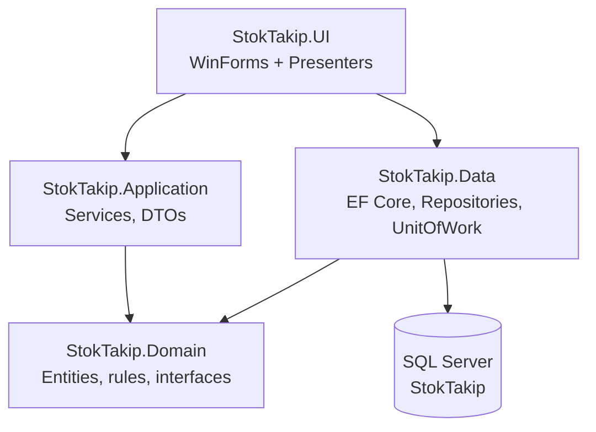
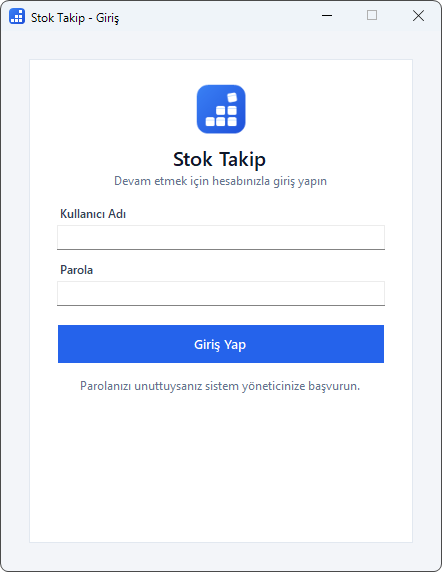
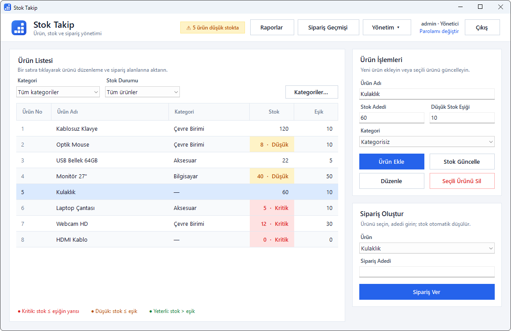
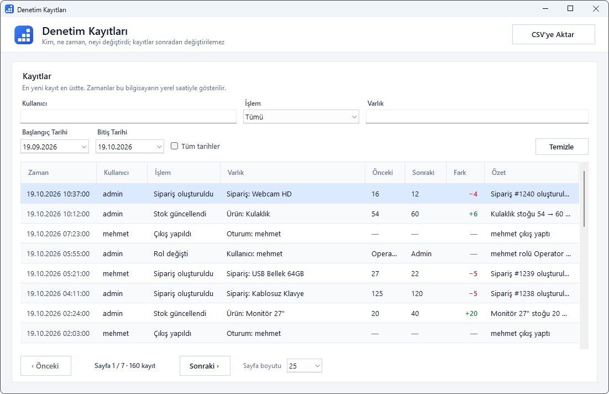
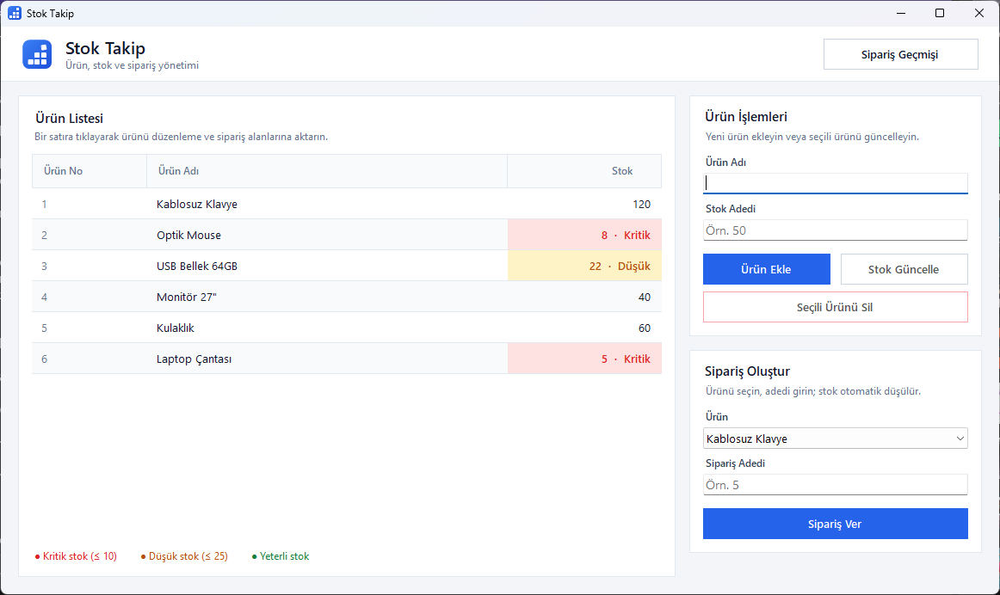
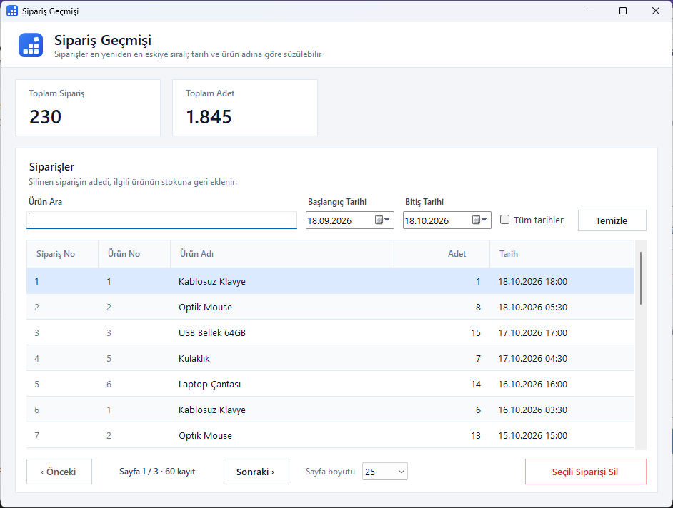
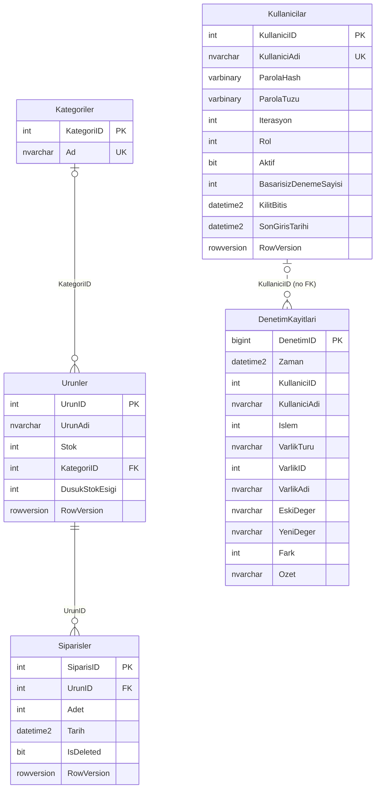

# 🧾 StokTakip - Simple Inventory and Order Tracking App (C# & MSSQL)

🇬🇧 **English** · 🇹🇷 [Türkçe](README.tr.md)

This project is a **simple inventory and order tracking application** built for small and medium-sized businesses. It is written in C# (WinForms, .NET 10) and uses MSSQL. After signing in, users can add products, view stock levels, create orders, filter and page through the order history, and run reports. Users with the Admin role can also delete orders, manage categories and users, export to CSV, and review the audit log.

The application has been moved to a layered architecture: business rules live in the Domain/Application layers, database access is handled with EF Core in the Data layer, and the user interface follows the MVP (Model-View-Presenter) pattern in the UI layer.

> The application's user interface is in Turkish. Screen, button and menu names below are given with their Turkish labels followed by an English translation, e.g. "Sipariş Geçmişi" (Order History).

---

## 📦 Features

- ✅ **User sign-in and roles**: every operation requires a session; there are two roles: **Yönetici (Admin)** and **Operatör (Operator)**. On first launch, the first admin account is created on the setup screen (there is no default password).
- ✅ **User management** (Admin): create users, change roles, activate/deactivate; the last active admin cannot be demoted or deactivated. Everyone can change their own password.
- ✅ Add products, update stock and delete products (a product that has orders cannot be deleted)
- ✅ **Categories**: products can be assigned to a category, and the product list can be filtered by category and stock status. If a category is deleted, its products become "kategorisiz" (uncategorized).
- ✅ **Per-product low stock threshold** (default 10): if stock is at or below the threshold it is shown as "Düşük" (Low, yellow); if it is zero or at or below half of the threshold it is shown as "Kritik" (Critical, red). The main form shows the number of low-stock products as a warning. Only an admin can change the threshold; a product added by an operator is saved with the default threshold.
- ✅ Create orders with automatic stock deduction (single transaction; an order is rejected if stock is insufficient)
- ✅ Order history: **paging** (25/50/100 records), **date range filter** (with an "Tüm tarihler" (All dates) option), **search by product name**, and a summary of total orders/quantity
- ✅ Delete orders (Admin): **soft delete** (the record is flagged with `IsDeleted`) and the deleted quantity is **returned to stock**; the main form and any open history windows refresh automatically
- ✅ **Reports**: best-selling products, daily and monthly order summaries (with a bar chart); the date range is limited to 5 years
- ✅ **CSV export** (Admin): order history and audit log, using the filters currently on screen. Opens directly in Excel (UTF-8 BOM, `;` separator). Cells starting with characters such as `= + - @` are prefixed with `'` to prevent **CSV/formula injection**. The file is first written to a temporary file in the same folder and moved to the target once complete; on error or cancellation an existing target file is left intact.
- ✅ **Audit log** (visible to Admin only): who did what and when; product, stock, order, category, threshold, user and session operations, as well as CSV exports, are recorded. For stock and threshold changes the old/new value and the difference (+/−) are stored. The timestamp is taken from the database server. Records cannot be modified or deleted through the application. The log can be filtered by user, action, entity and date range, paged, and exported to CSV.
- ✅ **Concurrency protection**: with `RowVersion`, if two people change the same record at the same time, the second operation is rejected, the list is refreshed and the user is warned
- ✅ A "Yükleniyor…" (Loading…) indicator during long operations, with buttons disabled while the operation runs
- ✅ Turkish error messages and file logging (Serilog); raw database error text is never shown to the user
- ✅ Application logo and icon (`assets/logo`)
- ✅ The database schema is created with EF Core migrations

### Permission matrix

Permissions are defined in `src/StokTakip.Application/Kimlik/Yetki.cs` and verified for every operation (no session, Operator, Admin) by the tests under `tests/StokTakip.Data.Tests/YetkiMatrisi`. A user who is not signed in cannot perform any operation.

| Operation | Operator | Admin |
|---|:---:|:---:|
| List and view products | ✓ | ✓ |
| Add and update products (name, stock, category) | ✓ | ✓ |
| Update stock | ✓ | ✓ |
| Change the low stock threshold | — | ✓ |
| Delete products | — | ✓ |
| Create orders | ✓ | ✓ |
| Order history and reports | ✓ | ✓ |
| Delete orders | — | ✓ |
| List categories | ✓ | ✓ |
| Add, rename and delete categories | — | ✓ |
| CSV export (order history, audit log) | — | ✓ |
| View the audit log | — | ✓ |
| User management (create, role, active status) | — | ✓ |
| Change own password | ✓ | ✓ |

Buttons the Operator has no permission for ("Ürün Sil" (Delete Product), "Kategoriler" (Categories), the "Yönetim" (Management) menu, "Sipariş Sil" (Delete Order), CSV) are hidden in the UI, and the threshold field becomes read-only. Independently of the UI, the same rules are also enforced in the service layer.

---

## 🧰 Tech Stack

| Area | Used |
|---|---|
| Platform | .NET 10 (`net10.0-windows` UI, `net10.0` libraries) |
| UI | Windows Forms (MVP: Presenter + View interfaces) |
| Data access | Entity Framework Core 10 (SQL Server provider), Microsoft.Data.SqlClient |
| Database | Microsoft SQL Server (SQLEXPRESS / LocalDB also work) |
| Configuration / DI | Microsoft.Extensions.Configuration.Json, Microsoft.Extensions.DependencyInjection |
| Logging | Serilog (file sink) |
| Identity | PBKDF2-HMAC-SHA256 (`Rfc2898DeriveBytes.Pbkdf2`), in-app roles |
| Testing | xUnit, NSubstitute, EF Core SQLite (in-memory), optional real SQL Server tests |
| CI | GitHub Actions (`.github/workflows/ci.yml`) |

---

## 🗂️ Project Structure

```text
StokTakipApp/
├── src/
│   ├── StokTakip.Domain/        # Entities (Urun, Siparis, Kategori, Kullanici, DenetimKaydi), business rule exceptions, repository interfaces
│   ├── StokTakip.Application/   # Services, Kimlik/ (sign-in, password, permissions), Denetim/, Raporlama/, DisaAktarim/ (CSV), DTOs
│   ├── StokTakip.Data/          # EF Core DbContext, repositories, UnitOfWork, audit log protection, Migrations/
│   └── StokTakip.UI/            # WinForms forms, presenters, Theme, appsettings.json
├── tests/
│   ├── StokTakip.Application.Tests/  # Service, domain rule, identity and CSV tests (NSubstitute)
│   ├── StokTakip.Data.Tests/         # Integration tests on SQLite, permission matrix, SqlServer/ (optional)
│   └── StokTakip.UI.Tests/           # Presenter, safe file writing and logging tests
├── docs/THREAT_MODEL.md         # Threat model (Turkish)
├── .github/workflows/ci.yml     # Build, test and release workflow
├── assets/logo/                 # Logo (SVG/PNG) and application icon (app.ico)
├── screenshots/                 # README screenshots
├── CHANGELOG.md
└── StokTakip.sln
```



The UI references Data only to register dependencies at startup; forms and presenters work through the Application services.

---

## 🛠️ Setup and Usage

### Requirements

- .NET 10 SDK
- SQL Server Express or LocalDB (Developer edition also works)
- Windows (the UI is WinForms)

Sample connection string (local SQL Server Express):

```text
Server=localhost\SQLEXPRESS;Database=StokTakip;Trusted_Connection=True;TrustServerCertificate=True;
```

In short:

```powershell
dotnet tool restore
dotnet ef database update --project src/StokTakip.Data --connection "Server=localhost\SQLEXPRESS;Database=StokTakip;Trusted_Connection=True;TrustServerCertificate=True;"
dotnet run --project src/StokTakip.UI
```

Details follow below.

### 1. Creating the Database (EF Core Migrations)

The database is no longer restored from a `.bak` file; `StokTakip.bak` is not included in the repository. The schema is created by the migrations under `src/StokTakip.Data/Migrations` (`InitialCreate`, `SiparisRowVersion`, `KategoriVeDusukStokEsigi`, `KullaniciKimlik`, `DenetimKaydi`).

The `dotnet-ef` tool is defined as a local tool in the repository (`.config/dotnet-tools.json`):

```powershell
dotnet tool restore
```

Migration commands are run against the **Data project**. Since the Data project contains its own design-time factory (`StokTakipDbContextFactory`), there is no need to pass `--startup-project`. Passing the UI project as the startup project (`--startup-project src/StokTakip.UI`) does not work, because the UI project does not reference the `Microsoft.EntityFrameworkCore.Design` package.

The commands do not read the connection string from `appsettings.json`. They look at the following, in order:

1. The `--connection "<connection string>"` parameter
2. The `STOKTAKIP_CONNECTION` environment variable
3. If neither is set, `Server=(localdb)\MSSQLLocalDB;Database=StokTakip;Integrated Security=true;TrustServerCertificate=true`

**New (empty) database:**

```powershell
# To see the migration list without connecting to the database:
dotnet ef migrations list --project src/StokTakip.Data --no-connect

# To create / update the database (use the same value as in appsettings.json):
$env:STOKTAKIP_CONNECTION = "Server=localhost\SQLEXPRESS;Database=StokTakip;Trusted_Connection=True;TrustServerCertificate=True;"
dotnet ef database update --project src/StokTakip.Data

# or directly, instead of the environment variable:
dotnet ef database update --project src/StokTakip.Data --connection "Server=localhost\SQLEXPRESS;Database=StokTakip;Trusted_Connection=True;TrustServerCertificate=True;"
```

The application does not run migrations at startup; the database must be created beforehand with this step.

**If you have a database restored from the old `.bak` file:**

Do not run `database update` directly against that database. Because the `Urunler` and `Siparisler` tables already exist, `InitialCreate` stops with the error "There is already an object named 'Urunler'". Recommended approach:

1. Create an empty database under a new name and run `dotnet ef database update` as shown above.
2. Copy the data over: turn on `SET IDENTITY_INSERT ... ON` and run `INSERT INTO yeni.dbo.Urunler (UrunID, UrunAdi, Stok) SELECT UrunID, UrunAdi, Stok FROM eski.dbo.Urunler` (`yeni` = new database, `eski` = old database). Then copy the `Siparisler (SiparisID, UrunID, Adet, Tarih)` table the same way, writing `0` to the `IsDeleted` column.
3. Before copying, check that there are no records with negative stock or with `Adet <= 0`; otherwise the CHECK constraints will refuse the inserts.

Alternative (in-place upgrade): add the missing columns, indexes and constraints to the old database by hand (`Siparisler.IsDeleted bit NOT NULL DEFAULT 0`, `Urunler.RowVersion rowversion`, `IX_Siparisler_UrunID`, `IX_Siparisler_Tarih`, the two CHECK constraints). Then mark the first migration as applied:

```sql
INSERT INTO __EFMigrationsHistory (MigrationId, ProductVersion)
VALUES (N'20261018173356_InitialCreate', N'10.0.13');
```

Then apply the remaining migrations (`Siparisler.RowVersion`, categories and threshold, users, audit log) with `dotnet ef database update`. With this approach the old PK/FK names remain different from the names EF would create; since a future migration touching these constraints could run into problems, the first approach should be preferred.

### 2. Configuration (appsettings.json)

The old `DatabaseHelper.cs` has been removed. The connection string now lives in `src/StokTakip.UI/appsettings.json` (copied to the output folder on build):

```json
{
  "ConnectionStrings": {
    "StokTakip": "Server=localhost\\SQLEXPRESS;Database=StokTakip;Trusted_Connection=True;TrustServerCertificate=True;"
  }
}
```

> The default value connects to a local SQL Server Express instance (`localhost\SQLEXPRESS`). If you use a different server, change the `Server=` part (inside JSON the `\` character is written as `\\`). For LocalDB: `Server=(localdb)\\MSSQLLocalDB`.

> ⚠️ **`TrustServerCertificate=True` is for development environments only.** Microsoft.Data.SqlClient uses an encrypted connection (`Encrypt=True`) by default; the self-signed certificate of a local SQLEXPRESS instance is rejected without this setting. In production, install a valid certificate on the server and remove this setting.

If the file is missing or corrupt, or the database cannot be reached, the application logs the error and shows a Turkish "Yeniden Dene / İptal" (Retry / Cancel) dialog.

### 3. Running

```powershell
dotnet run --project src/StokTakip.UI
```

or open `StokTakip.sln` in Visual Studio, set `StokTakip.UI` as the startup project and run it. The output file is `StokTakip.exe`.

### 4. First Launch and Sign-in

- **Initial setup:** If there are no users in the database, the application opens with the "İlk Kurulum" (Initial Setup) screen, where the first **Admin** account is created. There is no preset user name and **no default password**. Once the users table has any rows, this screen never opens again; other users are added from the "Yönetim ▸ Kullanıcılar" (Management ▸ Users) screen.
- **Password policy:** at least 10 characters (at most 128), at least one letter and one digit, and it cannot contain the user name. The setup screen marks the rules as you type. User names are 3–50 characters.
- **Sign-in lockout:** After 5 consecutive failed password attempts the account is locked for 15 minutes. The lock is lifted automatically when the time is up. The sign-in screen does not reveal whether the account exists or is locked; the same generic message is shown on every failed attempt.
- A signed-in user can change their own password with the "Parolamı değiştir" (Change my password) link in the header, and return to the sign-in screen with "Çıkış" (Sign out). If the account is deactivated or demoted from another computer, the session is closed or the permissions are narrowed on the next operation.

### 5. Logs

Logs are written daily to `%LOCALAPPDATA%\StokTakip\logs\stoktakip-YYYYMMDD.log` files and kept for **the last 14 days**. Settings are in the `Serilog` section of `appsettings.json`; a relative `path` is resolved under `%LOCALAPPDATA%\StokTakip`. If the settings file is missing or invalid, logs are written to the same folder with default settings. For unhandled errors the user sees a Turkish message; the details (stack trace) appear only in the log file.

---

## 🔐 Security

For a detailed threat analysis, see [docs/THREAT_MODEL.md](docs/THREAT_MODEL.md) (Turkish).

### Implemented controls

- **Password storage:** Passwords are not stored in plain text. PBKDF2-HMAC-SHA256 is used with a random 16-byte salt per user and at least 600,000 iterations; the iteration count is stored with the hash, and if it is raised in the future, an old hash is upgraded on the next successful sign-in. The comparison is constant-time (`CryptographicOperations.FixedTimeEquals`).
- **User enumeration protection:** A non-existent user, a wrong password and a locked account all return the same generic message. The same expensive password verification is also performed for non-existent or locked accounts, so they cannot be told apart by response time.
- **Permission check on every operation:** The role is not read from the session alone. On every operation the user's current record is read from the database; if the record has been deleted, deactivated or demoted, the operation is rejected and the session is closed. Permission rules are enforced in the service layer independently of the UI.
- **Immutability of the audit log:** Audit records are append-only; updates and deletes through the application (EF Core `SaveChanges`) are rejected. The record is written in the same transaction as the operation; if the operation is rolled back, the record is not created either. The timestamp is taken from the database server (`SYSUTCDATETIME()`), not the client clock. Passwords and password hashes are never written to the log.
- **Parameterized queries:** All database access goes through EF Core; there is no hand-concatenated SQL text. In searches, the `%`, `_` and `[` characters are escaped.
- **CSV security:** Cell escaping against formula injection; export is available to Admin only, and the permission is re-checked at the end of the export. The file is written via a temporary file; only the `.csv` extension is allowed, and writing to the application and log folders is refused. Every export is recorded in the audit log.
- **Log sanitization:** User-controlled text is stripped of control characters and truncated before being logged (against log injection). Passwords are not logged, and raw database or exception text is never shown to the user; details are written to the log file only.

### Known limitations

- **Roles apply only inside the application.** Since the connection is made with `Trusted_Connection=True`, the database is accessed with the Windows account that runs the application. If that account has direct write access on SQL Server (via SSMS/`sqlcmd`), it can bypass the application and modify the tables, users' roles and the audit log. In production, separate the database accounts and roles: grant application users only the table permissions they need, and do not grant direct modification rights on the `Kullanicilar` and `DenetimKayitlari` tables.
- **`TrustServerCertificate=True` is for local/development environments only.** Because the server certificate is not validated, an attacker on the network can intercept the connection (man-in-the-middle). In setups that use a remote server, install a valid certificate on the server and remove this setting.
- The audit log timestamp comes from the server; **order dates and the sign-in lockout duration, however, are still calculated from the client clock.** A client with an incorrectly set clock can write orders with past or future dates.
- There is no session timeout; a session lasts until the user signs out or the application is closed.
- An admin cannot reset another user's password or unlock an account manually (the lock is lifted automatically after 15 minutes).

---

## 🖥️ Screenshots

### 📌 Sign-in Screen ("Giriş")
> Sign in with user name and password; a generic warning is shown on failed attempts



---

### 📌 Main Form (Admin)
> Admin session: category and stock status filters, per-product threshold column, low stock warning, the "Yönetim" (Management) menu and user info



---

### 📌 Audit Log ("Denetim Kayıtları")
> Who did what and when: user/action/entity/date filters, old and new values, difference, paging and CSV export



---

### 📌 Main Form
> Product list (with low/critical stock coloring), product operations and order creation screen



---

### 📌 Order History Form ("Sipariş Geçmişi")
> Total orders/quantity summary, product search, date range filter, paging and order deletion screen



> Screenshots of the first version are kept for comparison in `screenshots/anaform.png` and `screenshots/siparisgecmisi.png`.

---

## 🧠 Structural Overview

### Classes

- **Urun** (Product, `StokTakip.Domain/Entities`)
  - Properties: `UrunId`, `UrunAdi` (at most 200 characters), `Stok`, `KategoriId`, `DusukStokEsigi` (default 10), `RowVersion`
  - Methods: `AdiDegistir`, `StokAyarla`, `StokEkle`, `StoktanDus` (`YetersizStokException` on insufficient stock), `KategoriyeAta`, `StokDurumunuHesapla`

- **Siparis** (Order, `StokTakip.Domain/Entities`)
  - Properties: `SiparisId`, `UrunId`, `Adet`, `Tarih`, `IsDeleted`, `RowVersion`
  - Methods: `Olustur` (deducts from stock), `Sil` (soft delete + stock return)

- **Kategori** (Category, `StokTakip.Domain/Entities`): `KategoriId`, `Ad` (at most 100 characters, unique)

- **Kullanici** (User, `StokTakip.Domain/Entities`)
  - Properties: `KullaniciId`, `KullaniciAdi` (3–50 characters, unique), password hash/salt/iterations, `Rol` (Operator/Admin), `Aktif`, `BasarisizDenemeSayisi`, `KilitBitis`, `SonGirisTarihi`, `RowVersion`
  - Rules: 15-minute lock after 5 failed attempts (`KilitEsigi`, `KilitSuresi`)

- **DenetimKaydi** (Audit record, `StokTakip.Domain/Entities`): `DenetimId`, `Zaman`, `KullaniciId`, `KullaniciAdi`, `Islem`, `VarlikTuru`, `VarlikId`, `VarlikAdi`, `EskiDeger`, `YeniDeger`, `Fark`, `Ozet`

- **Services** (`StokTakip.Application`)
  - `StokService`: list, add, update, adjust stock, delete products
  - `SiparisService`: create and delete orders (within a transaction), paged order history, summary
  - `KategoriService`: list, add, rename, delete categories
  - `RaporService`: best sellers, daily and monthly summaries
  - `SiparisDisaAktarimService`: export order history to CSV
  - `KimlikService`: initial setup, sign-in/sign-out, password change, user management
  - `DenetimService` / `DenetimKaydedici`: query, export to CSV and write audit records
  - `YetkiDenetimli*` wrappers: before every service call, verify the permission against the user's current record in the database

### SQL Tables

- `Urunler (UrunID, UrunAdi, Stok, KategoriID, DusukStokEsigi, RowVersion)` — products
  - `UrunID int IDENTITY` — PK: `PK_Urunler`
  - `UrunAdi nvarchar(200) NOT NULL`
  - `Stok int NOT NULL` — `CK_Urunler_Stok`: `Stok >= 0`
  - `KategoriID int NULL` — FK: `Kategoriler` (`ON DELETE SET NULL`: when a category is deleted, the product becomes uncategorized), index: `IX_Urunler_KategoriID`
  - `DusukStokEsigi int NOT NULL DEFAULT 10` — `CK_Urunler_DusukStokEsigi`: `DusukStokEsigi >= 0`
  - `RowVersion rowversion` — concurrency check
- `Kategoriler (KategoriID, Ad)` — categories
  - `KategoriID int IDENTITY` — PK: `PK_Kategoriler`
  - `Ad nvarchar(100) NOT NULL` — unique index: `IX_Kategoriler_Ad` (comparison follows the database collation)
- `Kullanicilar (KullaniciID, KullaniciAdi, ParolaHash, ParolaTuzu, Iterasyon, Rol, Aktif, BasarisizDenemeSayisi, KilitBitis, SonGirisTarihi, RowVersion)` — users
  - `KullaniciID int IDENTITY` — PK: `PK_Kullanicilar`
  - `KullaniciAdi nvarchar(50) NOT NULL` — unique index, `CK_Kullanicilar_KullaniciAdi`: cannot be empty
  - `ParolaHash varbinary(64)`, `ParolaTuzu varbinary(32)`, `Iterasyon int` — `CK_Kullanicilar_Iterasyon`: `Iterasyon > 0`
  - `Rol int` — `CK_Kullanicilar_Rol`: `Rol IN (0, 1)` (0: Operator, 1: Admin)
  - `Aktif bit`, `BasarisizDenemeSayisi int` (`>= 0`), `KilitBitis datetime2 NULL`, `SonGirisTarihi datetime2 NULL`
  - `RowVersion rowversion` — so that concurrent failed attempts are not lost from the counter
- `DenetimKayitlari (DenetimID, Zaman, KullaniciID, KullaniciAdi, Islem, VarlikTuru, VarlikID, VarlikAdi, EskiDeger, YeniDeger, Fark, Ozet)` — audit log
  - `DenetimID bigint IDENTITY` — PK: `PK_DenetimKayitlari`
  - `Zaman datetime2 NOT NULL DEFAULT SYSUTCDATETIME()` — server time (UTC)
  - `KullaniciID int NULL`, `KullaniciAdi nvarchar(50)` — the user who performed the operation; there is no FK, and the user name is stored separately in the record
  - `Islem int` — action type (product added, stock updated, order deleted, sign-in failed, CSV exported, etc.)
  - `VarlikTuru nvarchar(30)`, `VarlikID int NULL`, `VarlikAdi nvarchar(200) NULL`
  - `EskiDeger`, `YeniDeger nvarchar(400) NULL`, `Fark int NULL`, `Ozet nvarchar(400)`
  - Indexes: `Zaman` (descending), `(Islem, Zaman)`, `(KullaniciID, Zaman)`
- `Siparisler (SiparisID, UrunID, Adet, Tarih, IsDeleted, RowVersion)` — orders
  - `SiparisID int IDENTITY` — PK: `PK_Siparisler`
  - `UrunID int NOT NULL` — FK: `FK_Siparisler_Urunler_UrunID` (`ON DELETE RESTRICT`: a product that has orders cannot be deleted), index: `IX_Siparisler_UrunID`
  - `Adet int NOT NULL` — `CK_Siparisler_Adet`: `Adet > 0`
  - `Tarih datetime2 NOT NULL DEFAULT GETDATE()` — index: `IX_Siparisler_Tarih`
  - `IsDeleted bit NOT NULL` — soft delete; deleted orders are filtered out of queries automatically
  - `RowVersion rowversion` — concurrency check



---

## 🧪 Testing Suggestions

### Manual testing

1. On first launch, create the admin account and sign in; add an Operator from the "Yönetim ▸ Kullanıcılar" (Management ▸ Users) screen.
2. Add a product; if stock is at or below the threshold the row is colored "Düşük" (Low), and if it is zero or at or below half of the threshold it is colored "Kritik" (Critical).
3. View and update the stock quantity.
4. Place an order (stock is deducted); an order for more than the available stock is rejected.
5. Open the "Sipariş Geçmişi" (Order History) form; search by product name, pick a date range, move between pages, export to CSV and open the file in Excel.
6. Delete an order; the quantity is added back to the product's stock and the main form updates automatically.
7. Sign in as an Operator; check that the delete, category, CSV and "Yönetim" (Management) buttons are not visible and that the threshold field is read-only.
8. On the "Yönetim ▸ Denetim Kayıtları" (Management ▸ Audit Log) screen, see the operations you performed, the old/new values and the failed sign-in attempts.
9. Open the application twice and change the same product in both windows; the second save is rejected with the warning "Kayıt başka biri tarafından değiştirildi" (The record was changed by someone else) and the list is refreshed.

### Automated tests

```powershell
dotnet test StokTakip.sln
```

| Project | Type | Scope | Result (`-c Release`) |
|---|---|---|---|
| `tests/StokTakip.Application.Tests` | Unit | Service and domain rules, identity/password, permission wrappers, CSV format (xUnit + NSubstitute) | 553 passed |
| `tests/StokTakip.Data.Tests` | Integration | End-to-end flows with real repositories, UnitOfWork and services, permission matrix; in-memory SQLite (`DataSource=:memory:`) | 421 passed, 47 skipped |
| `tests/StokTakip.UI.Tests` | UI | Presenter flows (CSV, sign-out), safe file writing, logging | 27 passed |

A total of 1001 tests pass. The 47 skipped tests are the SQL Server tests, which run only when the environment variable below is set; a normal `dotnet test` run does not require SQL Server.

**SQL Server tests** (`tests/StokTakip.Data.Tests/SqlServer`):

```powershell
$env:STOKTAKIP_SQL_TEST='Server=localhost\SQLEXPRESS;Trusted_Connection=True;TrustServerCertificate=True;'
dotnet test tests/StokTakip.Data.Tests --filter "FullyQualifiedName~SqlServer"
Remove-Item Env:STOKTAKIP_SQL_TEST
```

- No database name is given in the connection string (if one is given, it is ignored). Each test class creates a temporary database named `StokTakip_Test_<8 digits>`, applies the real migrations, and drops the database when the class finishes (even if tests fail). The `StokTakip` database is not touched.
- If the test run is interrupted, a temporary database may be left behind; you can drop databases whose names start with `StokTakip_Test_` by hand.
- Scope: schema and CHECK/uniqueness constraints, concurrent order/delete/initial setup races, Turkish search and sorting, reports, audit log and CSV.

**How the SQLite tests differ from SQL Server:**

- **Isolation / concurrency:** SQLite has a single writer and upgrades a `ReadCommitted` request to `Serializable`; two connections cannot open transactions at the same time. Therefore the locking and isolation races of SQL Server cannot be reproduced on SQLite; the SQLite tests only verify the `RowVersion` check (that an UPDATE/DELETE with a stale value is rejected), and the `RowVersion` value is produced by the test infrastructure rather than the database. Real races are tested in the SQL Server tests.
- **Collation (Turkish letters and sorting):** SQLite LIKE is case-insensitive only for ASCII letters, and sorting is ordinal. On SQL Server (`Turkish_CI_AS`), letters such as `İ/i`, `I/ı`, `ş/Ş` are matched and sorted according to Turkish rules. For this reason, the category name duplicate check is left to the database collation on SQL Server, while the user name search in the audit log is done by converting to lowercase; both are verified by the SQL Server tests.
- **`[` LIKE escaping:** In searches, the `%`, `_` and `[` characters are escaped. Since `[` is not a wildcard in SQLite in the first place, a bug in this escaping only shows up on SQL Server.
- The schema is created with `EnsureCreated` rather than migrations; `nvarchar` length limits are not enforced on SQLite (the limits are tested in the domain layer). CHECK constraints and FK behavior are tested on SQLite as well.

---

## 🚀 CI and Release

`.github/workflows/ci.yml` runs on every push to the `main` branch, on pull requests opened against `main`, and on `v*` tags (Windows, .NET 10):

1. **Build:** `dotnet build StokTakip.sln -c Release -warnaserror` (warnings are treated as errors)
2. **Test:** all tests with code coverage via `dotnet test`; results are uploaded as workflow artifacts
3. **Vulnerable package check:** `dotnet list package --vulnerable --include-transitive`; the workflow fails if any known vulnerable package is found
4. **Migration check:** `dotnet ef migrations has-pending-model-changes`; the workflow fails if the model has changes not captured in a migration
5. **Release (only on `v*` tags):** a single-file, self-contained build for win-x64 is published and packaged as `StokTakip-<tag>-win-x64.zip`

To produce the same release locally:

```powershell
dotnet publish src/StokTakip.UI/StokTakip.UI.csproj -c Release -r win-x64 --self-contained true -p:PublishSingleFile=true -p:IncludeNativeLibrariesForSelfExtract=true -p:EnableCompressionInSingleFile=true -o ./publish
```

- The output folder contains `StokTakip.exe` and `appsettings.json`. **`appsettings.json` must stay next to the exe**; the connection string and log settings are read from it. When distributing, copy the folder as a whole.
- The target machine does not need .NET installed. The compressed single file is about **56 MiB** (~130 MiB uncompressed).
- The database must still be created beforehand with `dotnet ef database update`; the application does not run migrations at startup.

---

## 👨‍💻 Developer Notes

- See [CHANGELOG.md](CHANGELOG.md) for the version history.
- The project was moved from .NET Framework 4.8 to .NET 10; the old `DatabaseHelper` class was removed and SQL operations were moved to EF Core repositories and `UnitOfWork` (no unparameterized SQL concatenation).
- Forms are passive views; the workflow lives in the presenters (`AnaFormPresenter`, `SiparisGecmisiPresenter`, `GirisPresenter`, `KullanicilarPresenter`, `DenetimKayitlariPresenter`, etc.). Each operation runs in its own DI scope (a separate `DbContext`); the session is pinned at the start of the operation, and if the session changes while the operation is running, the result is discarded.
- The startup flow is in `UygulamaAkisi`: database access → "İlk Kurulum" (Initial Setup) if needed → "Giriş" (Sign-in) → main form. On sign-out or when the session ends, open windows are closed and the sign-in screen is shown again.
- `Form1` and `SiparisGecmisiForm` do not hold references to each other; changes are communicated through `StokDegisiklikBildirimi` events (when an order is created, open history windows refresh; when an order is deleted, the main form refreshes).
- Database calls are async; in the order history a new query cancels the previous one, and pending queries are cancelled when the form closes.
- Business rule violations (`YetersizStokException`, `GecersizGirdiException`, `EszamanlilikException`, `YetkisizIslemException`, etc.) are shown as Turkish warnings. Operations such as deletes ask for confirmation with a MessageBox first.
- The look and feel is centralized in the `Theme` class (colors, fonts, high-DPI support). The stock status rule lives in the domain layer (`Urun.StokDurumunuHesapla`, default threshold `Urun.VarsayilanDusukStokEsigi = 10`).

---

## 🧳 License

This project is licensed under the MIT License. See [LICENSE](LICENSE).
