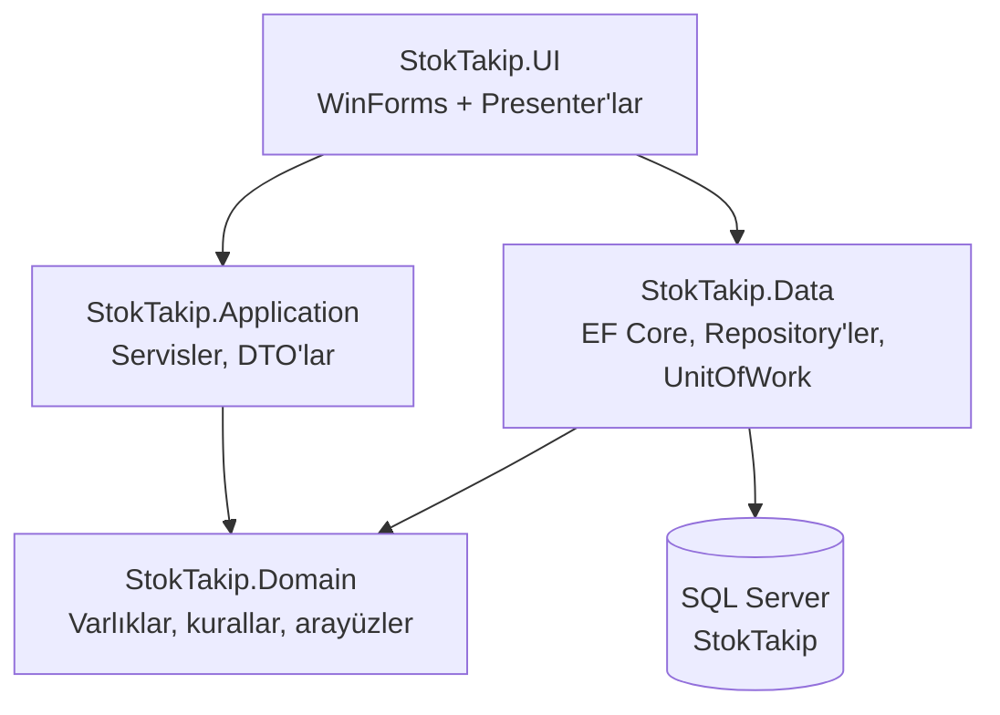
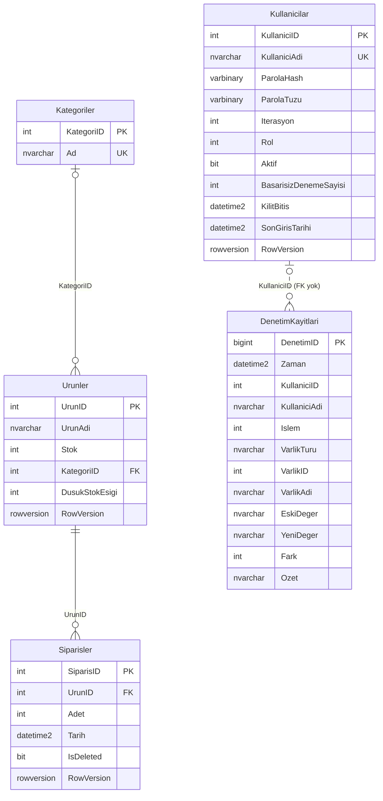

# 🧾 StokTakip - Basit Stok ve Sipariş Takip Uygulaması (C# & MSSQL)

Bu proje, küçük ve orta ölçekli işletmeler için geliştirilen **basit bir stok ve sipariş takip uygulamasıdır**. C# (WinForms, .NET 10) ve MSSQL kullanılarak geliştirilmiştir. Kullanıcılar oturum açarak ürün ekleyebilir, stok miktarlarını görüntüleyebilir, sipariş oluşturabilir, sipariş geçmişini filtreleyip sayfa sayfa görüntüleyebilir ve rapor alabilir. Yönetici rolündeki kullanıcılar ayrıca sipariş silebilir, kategori ve kullanıcı yönetebilir, CSV dışa aktarabilir ve denetim kayıtlarını inceleyebilir.

Uygulama katmanlı bir yapıya taşınmıştır: iş kuralları Domain/Application katmanlarında, veritabanı erişimi EF Core ile Data katmanında, arayüz ise MVP (Model-View-Presenter) düzeninde UI katmanında bulunur.

---

## 📦 Özellikler

- ✅ **Kullanıcı girişi ve roller**: her işlem için oturum gerekir; iki rol vardır: **Yönetici (Admin)** ve **Operatör**. İlk açılışta ilk yönetici hesabı kurulum ekranından oluşturulur (varsayılan parola yoktur).
- ✅ **Kullanıcı yönetimi** (Yönetici): kullanıcı oluşturma, rol değiştirme, aktif/pasif yapma; son aktif yönetici düşürülemez ve pasifleştirilemez. Herkes kendi parolasını değiştirebilir.
- ✅ Ürün ekleme, stok güncelleme ve silme (siparişi olan ürün silinemez)
- ✅ **Kategoriler**: ürünler kategoriye atanabilir, ürün listesi kategoriye ve stok durumuna göre filtrelenir. Kategori silinirse ürünleri "kategorisiz" kalır.
- ✅ **Ürün bazlı düşük stok eşiği** (varsayılan 10): stok eşiğe eşit ya da altındaysa "Düşük" (sarı), sıfırsa ya da eşiğin yarısına eşit veya altındaysa "Kritik" (kırmızı). Ana formda düşük stoktaki ürün sayısı uyarı olarak gösterilir. Eşiği yalnızca yönetici değiştirebilir; operatörün eklediği ürün varsayılan eşikle kaydedilir.
- ✅ Sipariş oluşturma ve stoktan otomatik düşme (tek transaction; yetersiz stokta sipariş reddedilir)
- ✅ Sipariş geçmişi: **sayfalama** (25/50/100 kayıt), **tarih aralığı filtresi** ("Tüm tarihler" seçeneğiyle), **ürün adına göre arama**, toplam sipariş/adet özeti
- ✅ Sipariş silme (Yönetici): **yumuşak silme** (kayıt `IsDeleted` ile işaretlenir) ve silinen adedin **stoğa iadesi**; ana form ve açık geçmiş pencereleri otomatik yenilenir
- ✅ **Raporlar**: en çok satan ürünler, günlük ve aylık sipariş özeti (çubuk grafikle); tarih aralığı en çok 5 yıl
- ✅ **CSV dışa aktarma** (Yönetici): sipariş geçmişi ve denetim kayıtları, ekrandaki filtrelerle. Excel ile doğrudan açılır (UTF-8 BOM, `;` ayırıcı). `= + - @` gibi karakterlerle başlayan hücrelerin önüne `'` eklenerek **CSV/formül enjeksiyonu** engellenir. Dosya önce aynı klasörde geçici bir dosyaya yazılır, tamamlanınca hedefe taşınır; hata ya da iptalde mevcut hedef dosya bozulmaz.
- ✅ **Denetim kaydı** (yalnızca Yönetici görür): kim, ne zaman, ne yaptı; ürün, stok, sipariş, kategori, eşik, kullanıcı ve oturum işlemleri ile CSV aktarımları kaydedilir. Stok ve eşik değişikliklerinde önceki/sonraki değer ve fark (+/−) tutulur. Kayıt zamanı veritabanı sunucusundan alınır. Kayıtlar uygulama üzerinden değiştirilemez ve silinemez. Kullanıcı, işlem, varlık ve tarih aralığına göre filtrelenir, sayfalanır ve CSV'ye aktarılır.
- ✅ **Eşzamanlılık koruması**: `RowVersion` ile aynı kaydı iki kişi aynı anda değiştirirse ikinci işlem reddedilir, liste yenilenir ve kullanıcı uyarılır
- ✅ Uzun işlemlerde "Yükleniyor…" göstergesi, işlem sürerken butonların pasifleşmesi
- ✅ Türkçe hata mesajları ve dosyaya loglama (Serilog); ham veritabanı hata metinleri kullanıcıya gösterilmez
- ✅ Uygulama logosu ve simgesi (`assets/logo`)
- ✅ Veritabanı şeması EF Core migration'ları ile oluşturulur

### Yetki matrisi

Yetkiler `src/StokTakip.Application/Kimlik/Yetki.cs` içinde tanımlıdır ve `tests/StokTakip.Data.Tests/YetkiMatrisi` altındaki testlerle her işlem için (oturumsuz, Operatör, Yönetici) doğrulanır. Oturum açmamış kullanıcı hiçbir işlemi yapamaz.

| İşlem | Operatör | Yönetici |
|---|:---:|:---:|
| Ürün listeleme ve görüntüleme | ✓ | ✓ |
| Ürün ekleme ve güncelleme (ad, stok, kategori) | ✓ | ✓ |
| Stok güncelleme | ✓ | ✓ |
| Düşük stok eşiğini değiştirme | — | ✓ |
| Ürün silme | — | ✓ |
| Sipariş oluşturma | ✓ | ✓ |
| Sipariş geçmişi ve raporlar | ✓ | ✓ |
| Sipariş silme | — | ✓ |
| Kategori listeleme | ✓ | ✓ |
| Kategori ekleme, yeniden adlandırma, silme | — | ✓ |
| CSV dışa aktarma (sipariş geçmişi, denetim) | — | ✓ |
| Denetim kayıtlarını görüntüleme | — | ✓ |
| Kullanıcı yönetimi (oluşturma, rol, aktiflik) | — | ✓ |
| Kendi parolasını değiştirme | ✓ | ✓ |

Operatör için yetkisi olmayan düğmeler (Ürün Sil, Kategoriler, Yönetim menüsü, Sipariş Sil, CSV) arayüzde gizlenir, eşik alanı salt okunur olur. Arayüzden bağımsız olarak aynı kurallar servis katmanında da uygulanır.

---

## 🧰 Teknoloji Yığını

| Alan | Kullanılan |
|---|---|
| Platform | .NET 10 (`net10.0-windows` UI, `net10.0` kütüphaneler) |
| Arayüz | Windows Forms (MVP: Presenter + View arayüzleri) |
| Veri erişimi | Entity Framework Core 10 (SQL Server sağlayıcısı), Microsoft.Data.SqlClient |
| Veritabanı | Microsoft SQL Server (SQLEXPRESS / LocalDB da olur) |
| Yapılandırma / DI | Microsoft.Extensions.Configuration.Json, Microsoft.Extensions.DependencyInjection |
| Loglama | Serilog (dosya çıkışı) |
| Kimlik | PBKDF2-HMAC-SHA256 (`Rfc2898DeriveBytes.Pbkdf2`), uygulama içi roller |
| Test | xUnit, NSubstitute, EF Core SQLite (bellek içi), isteğe bağlı gerçek SQL Server testleri |
| CI | GitHub Actions (`.github/workflows/ci.yml`) |

---

## 🗂️ Proje Yapısı

```text
StokTakipApp/
├── src/
│   ├── StokTakip.Domain/        # Varlıklar (Urun, Siparis, Kategori, Kullanici, DenetimKaydi), iş kuralı istisnaları, repository arayüzleri
│   ├── StokTakip.Application/   # Servisler, Kimlik/ (giriş, parola, yetki), Denetim/, Raporlama/, DisaAktarim/ (CSV), DTO'lar
│   ├── StokTakip.Data/          # EF Core DbContext, repository'ler, UnitOfWork, denetim kaydı koruması, Migrations/
│   └── StokTakip.UI/            # WinForms formları, Presenter'lar, Theme, appsettings.json
├── tests/
│   ├── StokTakip.Application.Tests/  # Servis, domain kuralı, kimlik ve CSV testleri (NSubstitute)
│   ├── StokTakip.Data.Tests/         # SQLite üzerinde entegrasyon testleri, yetki matrisi, SqlServer/ (isteğe bağlı)
│   └── StokTakip.UI.Tests/           # Presenter, güvenli dosya yazımı ve günlük testleri
├── docs/THREAT_MODEL.md         # Tehdit modeli
├── .github/workflows/ci.yml     # Derleme, test ve yayın iş akışı
├── assets/logo/                 # Logo (SVG/PNG) ve uygulama simgesi (app.ico)
├── screenshots/                 # README ekran görüntüleri
├── CHANGELOG.md
└── StokTakip.sln
```



UI yalnızca açılışta bağımlılıkları kaydetmek için Data'ya başvurur; formlar ve presenter'lar Application servisleri üzerinden çalışır.

---

## 🛠️ Kurulum ve Kullanım

### Gereksinimler

- .NET 10 SDK
- SQL Server Express veya LocalDB (Developer sürümü de olur)
- Windows (arayüz WinForms olduğu için)

Örnek bağlantı dizesi (yerel SQL Server Express):

```text
Server=localhost\SQLEXPRESS;Database=StokTakip;Trusted_Connection=True;TrustServerCertificate=True;
```

Kısaca:

```powershell
dotnet tool restore
dotnet ef database update --project src/StokTakip.Data --connection "Server=localhost\SQLEXPRESS;Database=StokTakip;Trusted_Connection=True;TrustServerCertificate=True;"
dotnet run --project src/StokTakip.UI
```

Ayrıntılar aşağıdadır.

### 1. Veritabanını Oluşturma (EF Core Migration)

Veritabanı artık `.bak` dosyasından restore edilmiyor; `StokTakip.bak` repoda yer almıyor. Şema, `src/StokTakip.Data/Migrations` altındaki migration'larla oluşturulur (`InitialCreate`, `SiparisRowVersion`, `KategoriVeDusukStokEsigi`, `KullaniciKimlik`, `DenetimKaydi`).

`dotnet-ef` aracı repoda yerel araç olarak tanımlıdır (`.config/dotnet-tools.json`):

```powershell
dotnet tool restore
```

Migration komutları **Data projesi** üzerinden çalıştırılır. Data projesi kendi tasarım zamanı fabrikasını (`StokTakipDbContextFactory`) içerdiği için ayrıca `--startup-project` vermeye gerek yoktur. UI projesini başlangıç projesi olarak vermek (`--startup-project src/StokTakip.UI`) çalışmaz, çünkü UI projesi `Microsoft.EntityFrameworkCore.Design` paketine başvurmaz.

Komutlar bağlantı dizesini `appsettings.json`'dan okumaz. Sırasıyla şunlara bakılır:

1. `--connection "<bağlantı dizesi>"` parametresi
2. `STOKTAKIP_CONNECTION` ortam değişkeni
3. Hiçbiri yoksa `Server=(localdb)\MSSQLLocalDB;Database=StokTakip;Integrated Security=true;TrustServerCertificate=true`

**Yeni (boş) veritabanı:**

```powershell
# Migration listesini veritabanına bağlanmadan görmek için:
dotnet ef migrations list --project src/StokTakip.Data --no-connect

# Veritabanını oluşturmak / güncellemek için (appsettings.json ile aynı değeri kullanın):
$env:STOKTAKIP_CONNECTION = "Server=localhost\SQLEXPRESS;Database=StokTakip;Trusted_Connection=True;TrustServerCertificate=True;"
dotnet ef database update --project src/StokTakip.Data

# veya ortam değişkeni yerine doğrudan:
dotnet ef database update --project src/StokTakip.Data --connection "Server=localhost\SQLEXPRESS;Database=StokTakip;Trusted_Connection=True;TrustServerCertificate=True;"
```

Uygulama açılışta migration çalıştırmaz; veritabanı bu adımla önceden oluşturulmalıdır.

**Eski `.bak` dosyasından restore edilmiş bir veritabanınız varsa:**

`database update` komutunu doğrudan bu veritabanında çalıştırmayın. `Urunler` ve `Siparisler` tabloları zaten var olduğu için `InitialCreate` "There is already an object named 'Urunler'" hatasıyla durur. Önerilen yol:

1. Yeni adla boş bir veritabanı oluşturup yukarıdaki gibi `dotnet ef database update` çalıştırın.
2. Verileri aktarın: `SET IDENTITY_INSERT ... ON` açıp `INSERT INTO yeni.dbo.Urunler (UrunID, UrunAdi, Stok) SELECT UrunID, UrunAdi, Stok FROM eski.dbo.Urunler` çalıştırın. Ardından aynı şekilde `Siparisler (SiparisID, UrunID, Adet, Tarih)` tablosunu aktarın, `IsDeleted` alanına `0` yazın.
3. Aktarımdan önce negatif stoklu ya da `Adet <= 0` olan kayıt olmadığını kontrol edin; aksi halde CHECK kısıtları eklemeyi reddeder.

Alternatif (yerinde yükseltme): eski veritabanına eksik sütun, index ve kısıtları elle ekleyin (`Siparisler.IsDeleted bit NOT NULL DEFAULT 0`, `Urunler.RowVersion rowversion`, `IX_Siparisler_UrunID`, `IX_Siparisler_Tarih`, iki CHECK kısıtı). Ardından ilk migration'ı uygulanmış olarak işaretleyin:

```sql
INSERT INTO __EFMigrationsHistory (MigrationId, ProductVersion)
VALUES (N'20261018173356_InitialCreate', N'10.0.13');
```

Sonra `dotnet ef database update` ile kalan migration'ları (`Siparisler.RowVersion`, kategoriler ve eşik, kullanıcılar, denetim kayıtları) uygulayın. Bu yolda eski PK/FK adları EF'in ürettiği adlardan farklı kalır; ileride bu kısıtlara dokunan bir migration sorun çıkarabileceği için ilk yol tercih edilmelidir.

### 2. Yapılandırma (appsettings.json)

Eski `DatabaseHelper.cs` kaldırıldı. Bağlantı dizesi artık `src/StokTakip.UI/appsettings.json` içindedir (derlemede çıktı klasörüne kopyalanır):

```json
{
  "ConnectionStrings": {
    "StokTakip": "Server=localhost\\SQLEXPRESS;Database=StokTakip;Trusted_Connection=True;TrustServerCertificate=True;"
  }
}
```

> Varsayılan değer yerel SQL Server Express örneğine (`localhost\SQLEXPRESS`) bağlanır. Farklı bir sunucu kullanıyorsanız `Server=` kısmını değiştirin (JSON içinde `\` karakteri `\\` olarak yazılır). LocalDB için: `Server=(localdb)\\MSSQLLocalDB`.

> ⚠️ **`TrustServerCertificate=True` yalnızca geliştirme ortamı içindir.** Microsoft.Data.SqlClient varsayılan olarak şifreli bağlantı (`Encrypt=True`) kullanır; yerel SQLEXPRESS'in kendinden imzalı sertifikası bu ayar olmadan reddedilir. Üretimde sunucuya geçerli bir sertifika kurun ve bu ayarı kaldırın.

Dosya eksikse, bozuksa ya da veritabanına bağlanılamazsa uygulama hatayı loglar ve Türkçe bir "Yeniden Dene / İptal" penceresi gösterir.

### 3. Çalıştırma

```powershell
dotnet run --project src/StokTakip.UI
```

veya Visual Studio'da `StokTakip.sln` açılıp `StokTakip.UI` başlangıç projesi yapılarak çalıştırılır. Çıktı dosyası `StokTakip.exe`'dir.

### 4. İlk Açılış ve Giriş

- **İlk kurulum:** Veritabanında hiç kullanıcı yoksa uygulama "İlk Kurulum" ekranıyla açılır ve ilk **Yönetici** hesabı burada oluşturulur. Hazır bir kullanıcı adı ya da **varsayılan parola yoktur**. Kullanıcılar tablosu doluysa bu ekran bir daha açılmaz; diğer kullanıcılar Yönetim ▸ Kullanıcılar ekranından eklenir.
- **Parola politikası:** en az 10 karakter (en fazla 128), en az bir harf ve bir rakam, kullanıcı adını içeremez. Kurulum ekranı kuralları yazarken işaretler. Kullanıcı adı 3–50 karakterdir.
- **Giriş kilidi:** Art arda 5 hatalı parola denemesinde hesap 15 dakika kilitlenir. Süre dolunca kilit kendiliğinden kalkar. Giriş ekranı, hesabın var olup olmadığını ya da kilitli olduğunu belli etmez; her başarısız denemede aynı genel mesaj gösterilir.
- Oturum açık kullanıcı başlıktaki "Parolamı değiştir" bağlantısıyla kendi parolasını değiştirebilir, "Çıkış" ile giriş ekranına döner. Hesap başka bir bilgisayardan pasifleştirilir ya da rolü düşürülürse bir sonraki işlemde oturum kapanır veya yetkiler daraltılır.

### 5. Loglar

Loglar `%LOCALAPPDATA%\StokTakip\logs\stoktakip-YYYYMMDD.log` dosyalarına günlük olarak yazılır ve **son 14 gün** saklanır. Ayarlar `appsettings.json` içindeki `Serilog` bölümündedir; göreli bir `path` verilirse `%LOCALAPPDATA%\StokTakip` altına çözülür. Ayar dosyası eksik veya hatalıysa aynı klasöre varsayılan ayarlarla yazılır. Yakalanmayan hatalarda kullanıcıya Türkçe mesaj gösterilir, ayrıntılar (yığın izi) yalnızca log dosyasında yer alır.

---

## 🔐 Güvenlik

Ayrıntılı tehdit analizi için [docs/THREAT_MODEL.md](docs/THREAT_MODEL.md) dosyasına bakın.

### Uygulanan önlemler

- **Parola saklama:** Parolalar düz metin olarak tutulmaz. PBKDF2-HMAC-SHA256, kullanıcı başına 16 baytlık rastgele tuz ve en az 600.000 iterasyon kullanılır; iterasyon sayısı özetle birlikte saklanır, ileride artırılırsa eski özet bir sonraki doğru girişte yenilenir. Karşılaştırma sabit zamanlıdır (`CryptographicOperations.FixedTimeEquals`).
- **Kullanıcı numaralandırma koruması:** Olmayan kullanıcı, yanlış parola ve kilitli hesap aynı genel mesajı döndürür. Olmayan ya da kilitli hesapta da aynı maliyetli parola doğrulaması yapılır, böylece yanıt süresinden ayırt edilemez.
- **Her işlemde yetki doğrulama:** Rol yalnızca oturumdan okunmaz. Her işlemde kullanıcının güncel kaydı veritabanından okunur; kayıt silinmiş, pasif ya da rolü düşmüşse işlem reddedilir ve oturum kapatılır. Yetki kuralları arayüzden bağımsız olarak servis katmanında uygulanır.
- **Denetim kaydının değiştirilemezliği:** Denetim kayıtları yalnızca eklenebilir; uygulama üzerinden (EF Core `SaveChanges`) güncelleme ve silme reddedilir. Kayıt, işlemle aynı transaction içinde yazılır; işlem geri alınırsa kayıt da oluşmaz. Kayıt zamanı istemci saatinden değil, veritabanı sunucusundan (`SYSUTCDATETIME()`) alınır. Parola ve parola özeti kayıtlara yazılmaz.
- **Parametreli sorgular:** Tüm veritabanı erişimi EF Core üzerindendir; elle birleştirilen SQL metni yoktur. Aramalarda `%`, `_` ve `[` karakterleri kaçışlanır.
- **CSV güvenliği:** Formül enjeksiyonuna karşı hücre kaçışı; dışa aktarma yalnızca Yönetici'ye açıktır ve aktarım sonunda yetki yeniden doğrulanır. Dosya geçici dosya üzerinden yazılır; yalnızca `.csv` uzantısına izin verilir, uygulama ve log klasörlerine yazma reddedilir. Her aktarım denetim kaydına düşer.
- **Log temizliği:** Kullanıcı kontrollü metinler loglanmadan önce kontrol karakterlerinden arındırılır ve kısaltılır (log enjeksiyonuna karşı). Parola loglanmaz, kullanıcıya ham veritabanı ya da istisna metni gösterilmez; ayrıntılar yalnızca log dosyasına yazılır.

### Bilinen sınırlar

- **Roller yalnızca uygulama içinde geçerlidir.** Bağlantı `Trusted_Connection=True` ile kurulduğu için veritabanına uygulamayı çalıştıran Windows hesabıyla bağlanılır. Bu hesabın SQL Server'da doğrudan yazma yetkisi varsa (SSMS/`sqlcmd` ile) tabloları, kullanıcıların rollerini ve denetim kayıtlarını uygulamayı atlayarak değiştirebilir. Üretimde veritabanı hesaplarını ve rollerini ayırın: uygulama kullanıcılarına yalnızca gereken tablo yetkilerini verin, `Kullanicilar` ve `DenetimKayitlari` tablolarına doğrudan değişiklik yetkisi vermeyin.
- **`TrustServerCertificate=True` yalnızca yerel/geliştirme ortamı içindir.** Sunucu sertifikası doğrulanmadığı için ağdaki bir saldırgan araya girebilir. Uzak sunucu kullanılan kurulumlarda sunucuya geçerli bir sertifika kurun ve bu ayarı kaldırın.
- Denetim kaydının zamanı sunucudan alınır; **sipariş tarihi ve giriş kilidi süresi ise hâlâ istemci saatine göre hesaplanır.** Saati yanlış ayarlanmış bir istemci geçmiş ya da gelecek tarihli sipariş yazabilir.
- Oturum zaman aşımı yoktur; oturum çıkış yapılana ya da uygulama kapanana kadar sürer.
- Yönetici başka bir kullanıcının parolasını sıfırlayamaz ve kilidi elle açamaz (kilit 15 dakikada kendiliğinden kalkar).

---

## 🖥️ Ekran Görüntüleri

### 📌 Giriş Ekranı
> Kullanıcı adı ve parola ile oturum açma; hatalı denemelerde genel bir uyarı gösterilir


---

### 📌 Ana Form (Yönetici)
> Yönetici oturumu: kategori ve stok durumu filtreleri, ürün bazlı eşik sütunu, düşük stok uyarısı, Yönetim menüsü ve kullanıcı bilgisi


---

### 📌 Denetim Kayıtları
> Kim, ne zaman, ne yaptı: kullanıcı/işlem/varlık/tarih filtreleri, önceki ve sonraki değer, fark, sayfalama ve CSV'ye aktarma


---

### 📌 Ana Form
> Ürün listesi (düşük/kritik stok renklendirmesiyle), ürün işlemleri ve sipariş oluşturma ekranı


---

### 📌 Sipariş Geçmişi Formu
> Toplam sipariş/adet özeti, ürün araması, tarih aralığı filtresi, sayfalama ve sipariş silme ekranı


> İlk sürümün ekran görüntüleri karşılaştırma için `screenshots/anaform.png` ve `screenshots/siparisgecmisi.png` dosyalarında duruyor.

---

## 🧠 Yapısal Bilgi

### Sınıflar

- **Urun** (`StokTakip.Domain/Entities`)
  - Özellikler: `UrunId`, `UrunAdi` (en fazla 200 karakter), `Stok`, `KategoriId`, `DusukStokEsigi` (varsayılan 10), `RowVersion`
  - Metodlar: `AdiDegistir`, `StokAyarla`, `StokEkle`, `StoktanDus` (yetersiz stokta `YetersizStokException`), `KategoriyeAta`, `StokDurumunuHesapla`

- **Siparis** (`StokTakip.Domain/Entities`)
  - Özellikler: `SiparisId`, `UrunId`, `Adet`, `Tarih`, `IsDeleted`, `RowVersion`
  - Metodlar: `Olustur` (stoktan düşer), `Sil` (yumuşak silme + stok iadesi)

- **Kategori** (`StokTakip.Domain/Entities`): `KategoriId`, `Ad` (en fazla 100 karakter, benzersiz)

- **Kullanici** (`StokTakip.Domain/Entities`)
  - Özellikler: `KullaniciId`, `KullaniciAdi` (3–50 karakter, benzersiz), parola özeti/tuzu/iterasyonu, `Rol` (Operatör/Yönetici), `Aktif`, `BasarisizDenemeSayisi`, `KilitBitis`, `SonGirisTarihi`, `RowVersion`
  - Kurallar: 5 hatalı denemede 15 dakika kilit (`KilitEsigi`, `KilitSuresi`)

- **DenetimKaydi** (`StokTakip.Domain/Entities`): `DenetimId`, `Zaman`, `KullaniciId`, `KullaniciAdi`, `Islem`, `VarlikTuru`, `VarlikId`, `VarlikAdi`, `EskiDeger`, `YeniDeger`, `Fark`, `Ozet`

- **Servisler** (`StokTakip.Application`)
  - `StokService`: ürün listeleme, ekleme, güncelleme, stok ayarlama, silme
  - `SiparisService`: sipariş oluşturma ve silme (transaction içinde), sayfalı sipariş geçmişi, özet
  - `KategoriService`: kategori listeleme, ekleme, yeniden adlandırma, silme
  - `RaporService`: en çok satanlar, günlük ve aylık özet
  - `SiparisDisaAktarimService`: sipariş geçmişini CSV'ye aktarma
  - `KimlikService`: ilk kurulum, giriş/çıkış, parola değiştirme, kullanıcı yönetimi
  - `DenetimService` / `DenetimKaydedici`: denetim kayıtlarını sorgulama, CSV'ye aktarma ve yazma
  - `YetkiDenetimli*` sarmalayıcıları: her servis çağrısından önce yetkiyi veritabanındaki güncel kullanıcı kaydıyla doğrular

### SQL Tabloları

- `Urunler (UrunID, UrunAdi, Stok, KategoriID, DusukStokEsigi, RowVersion)`
  - `UrunID int IDENTITY` — PK: `PK_Urunler`
  - `UrunAdi nvarchar(200) NOT NULL`
  - `Stok int NOT NULL` — `CK_Urunler_Stok`: `Stok >= 0`
  - `KategoriID int NULL` — FK: `Kategoriler` (`ON DELETE SET NULL`: kategori silinince ürün kategorisiz kalır), index: `IX_Urunler_KategoriID`
  - `DusukStokEsigi int NOT NULL DEFAULT 10` — `CK_Urunler_DusukStokEsigi`: `DusukStokEsigi >= 0`
  - `RowVersion rowversion` — eşzamanlılık denetimi
- `Kategoriler (KategoriID, Ad)`
  - `KategoriID int IDENTITY` — PK: `PK_Kategoriler`
  - `Ad nvarchar(100) NOT NULL` — benzersiz index: `IX_Kategoriler_Ad` (karşılaştırma veritabanı kollasyonuna göre)
- `Kullanicilar (KullaniciID, KullaniciAdi, ParolaHash, ParolaTuzu, Iterasyon, Rol, Aktif, BasarisizDenemeSayisi, KilitBitis, SonGirisTarihi, RowVersion)`
  - `KullaniciID int IDENTITY` — PK: `PK_Kullanicilar`
  - `KullaniciAdi nvarchar(50) NOT NULL` — benzersiz index, `CK_Kullanicilar_KullaniciAdi`: boş olamaz
  - `ParolaHash varbinary(64)`, `ParolaTuzu varbinary(32)`, `Iterasyon int` — `CK_Kullanicilar_Iterasyon`: `Iterasyon > 0`
  - `Rol int` — `CK_Kullanicilar_Rol`: `Rol IN (0, 1)` (0: Operatör, 1: Yönetici)
  - `Aktif bit`, `BasarisizDenemeSayisi int` (`>= 0`), `KilitBitis datetime2 NULL`, `SonGirisTarihi datetime2 NULL`
  - `RowVersion rowversion` — eşzamanlı hatalı denemelerin sayaçtan kaybolmaması için
- `DenetimKayitlari (DenetimID, Zaman, KullaniciID, KullaniciAdi, Islem, VarlikTuru, VarlikID, VarlikAdi, EskiDeger, YeniDeger, Fark, Ozet)`
  - `DenetimID bigint IDENTITY` — PK: `PK_DenetimKayitlari`
  - `Zaman datetime2 NOT NULL DEFAULT SYSUTCDATETIME()` — sunucu saati (UTC)
  - `KullaniciID int NULL`, `KullaniciAdi nvarchar(50)` — işlemi yapan; FK yoktur, kullanıcı adı kayıtta ayrıca saklanır
  - `Islem int` — işlem türü (ürün eklendi, stok güncellendi, sipariş silindi, giriş başarısız, CSV aktarıldı vb.)
  - `VarlikTuru nvarchar(30)`, `VarlikID int NULL`, `VarlikAdi nvarchar(200) NULL`
  - `EskiDeger`, `YeniDeger nvarchar(400) NULL`, `Fark int NULL`, `Ozet nvarchar(400)`
  - Index'ler: `Zaman` (azalan), `(Islem, Zaman)`, `(KullaniciID, Zaman)`
- `Siparisler (SiparisID, UrunID, Adet, Tarih, IsDeleted, RowVersion)`
  - `SiparisID int IDENTITY` — PK: `PK_Siparisler`
  - `UrunID int NOT NULL` — FK: `FK_Siparisler_Urunler_UrunID` (`ON DELETE RESTRICT`: siparişi olan ürün silinemez), index: `IX_Siparisler_UrunID`
  - `Adet int NOT NULL` — `CK_Siparisler_Adet`: `Adet > 0`
  - `Tarih datetime2 NOT NULL DEFAULT GETDATE()` — index: `IX_Siparisler_Tarih`
  - `IsDeleted bit NOT NULL` — yumuşak silme; silinen siparişler sorgularda otomatik filtrelenir
  - `RowVersion rowversion` — eşzamanlılık denetimi



---

## 🧪 Test İçin Öneri

### Elle deneme

1. İlk açılışta yönetici hesabını oluşturun ve giriş yapın; Yönetim ▸ Kullanıcılar ekranından bir Operatör ekleyin.
2. Ürün ekleyin; stok eşiğe eşit ya da altındaysa satır "Düşük", sıfırsa ya da eşiğin yarısına eşit veya altındaysa "Kritik" olarak renklenir.
3. Stok miktarını görüntüleyin ve güncelleyin.
4. Sipariş verin (stoktan düşer); mevcut stoktan fazla adet girildiğinde sipariş reddedilir.
5. Sipariş geçmişi formunu açın; ürün adıyla arayın, tarih aralığı seçin, sayfalar arasında gezinin, CSV'ye aktarın ve dosyayı Excel'de açın.
6. Bir siparişi silin; adet ürünün stoğuna geri eklenir, ana form otomatik güncellenir.
7. Operatör olarak giriş yapın; silme, kategori, CSV ve Yönetim düğmelerinin görünmediğini, eşik alanının salt okunur olduğunu görün.
8. Yönetim ▸ Denetim Kayıtları ekranında yaptığınız işlemleri, önceki/sonraki değerleri ve başarısız giriş denemelerini görün.
9. Uygulamayı iki kez açıp aynı ürünü iki pencerede değiştirin; ikinci kayıt "Kayıt başka biri tarafından değiştirildi" uyarısıyla reddedilir ve liste yenilenir.

### Otomatik testler

```powershell
dotnet test StokTakip.sln
```

| Proje | Tür | Kapsam | Sonuç (`-c Release`) |
|---|---|---|---|
| `tests/StokTakip.Application.Tests` | Birim | Servis ve domain kuralları, kimlik/parola, yetki sarmalayıcıları, CSV biçimi (xUnit + NSubstitute) | 553 geçti |
| `tests/StokTakip.Data.Tests` | Entegrasyon | Gerçek repository, UnitOfWork ve servislerle uçtan uca akışlar, yetki matrisi; bellek içi SQLite (`DataSource=:memory:`) | 421 geçti, 47 atlandı |
| `tests/StokTakip.UI.Tests` | UI | Presenter akışları (CSV, çıkış), güvenli dosya yazımı, günlük | 27 geçti |

Toplam 1001 test geçer. Atlanan 47 test SQL Server testleridir ve yalnızca aşağıdaki ortam değişkeni tanımlıysa çalışır; normal `dotnet test` SQL Server gerektirmez.

**SQL Server testleri** (`tests/StokTakip.Data.Tests/SqlServer`):

```powershell
$env:STOKTAKIP_SQL_TEST='Server=localhost\SQLEXPRESS;Trusted_Connection=True;TrustServerCertificate=True;'
dotnet test tests/StokTakip.Data.Tests --filter "FullyQualifiedName~SqlServer"
Remove-Item Env:STOKTAKIP_SQL_TEST
```

- Bağlantı dizesinde veritabanı adı verilmez (verilse de yok sayılır). Her test sınıfı `StokTakip_Test_<8 hane>` adlı geçici bir veritabanı kurar, gerçek migration'ları uygular ve sınıf bitince (testler başarısız olsa bile) veritabanını siler. `StokTakip` veritabanına dokunulmaz.
- Test süreci yarıda kesilirse geçici veritabanı kalabilir; `StokTakip_Test_` ile başlayan veritabanlarını elle silebilirsiniz.
- Kapsam: şema ve CHECK/benzersizlik kısıtları, eşzamanlı sipariş/silme/ilk kurulum yarışları, Türkçe arama ve sıralama, raporlar, denetim kaydı ve CSV.

**SQLite testlerinin SQL Server'dan farkları:**

- **İzolasyon / eşzamanlılık:** SQLite tek yazıcılıdır ve `ReadCommitted` isteğini `Serializable`'a yükseltir; iki bağlantı aynı anda transaction açamaz. Bu yüzden SQL Server'daki kilit ve izolasyon yarışları SQLite'ta üretilemez; SQLite testleri yalnızca `RowVersion` denetimini (eski değerle yapılan UPDATE/DELETE'in reddedilmesini) doğrular ve `RowVersion` değerini veritabanı değil test altyapısı üretir. Gerçek yarışlar SQL Server testlerinde sınanır.
- **Kollasyon (Türkçe harfler ve sıralama):** SQLite LIKE yalnızca ASCII harflerde büyük/küçük harf duyarsızdır ve sıralama ordinaldir. SQL Server'da (`Turkish_CI_AS`) `İ/i`, `I/ı`, `ş/Ş` gibi harfler Türkçe kurala göre eşleşir ve sıralanır. Bu yüzden kategori adı tekrar kontrolü SQL Server'da veritabanının kollasyonuna bırakılmıştır, denetim kayıtlarındaki kullanıcı adı araması ise küçük harfe çevrilerek yapılır; ikisi de SQL Server testleriyle doğrulanır.
- **`[` LIKE kaçışı:** Aramalarda `%`, `_` ve `[` karakterleri kaçışlanır. SQLite'ta `[` zaten joker karakter olmadığından bu kaçışın hatası yalnızca SQL Server'da ortaya çıkar.
- Şema migration'larla değil `EnsureCreated` ile oluşturulur; `nvarchar` uzunluk sınırları SQLite'ta zorlanmaz (sınırlar domain katmanında test edilir). CHECK kısıtları ve FK davranışı SQLite'ta da test edilir.

---

## 🚀 CI ve Yayın

`.github/workflows/ci.yml`, `main` dalına gönderilen her değişiklikte, `main`'e açılan pull request'lerde ve `v*` etiketlerinde çalışır (Windows, .NET 10):

1. **Derleme:** `dotnet build StokTakip.sln -c Release -warnaserror` (uyarılar hata sayılır)
2. **Test:** `dotnet test` ile tüm testler ve kod kapsamı; sonuçlar iş akışı çıktısı olarak yüklenir
3. **Zafiyetli paket kontrolü:** `dotnet list package --vulnerable --include-transitive`; bilinen zafiyetli paket varsa iş akışı başarısız olur
4. **Migration kontrolü:** `dotnet ef migrations has-pending-model-changes`; modelde migration'a dökülmemiş değişiklik varsa iş akışı başarısız olur
5. **Yayın (yalnızca `v*` etiketinde):** win-x64 için tek dosyalı, bağımsız (self-contained) yayın alınır ve `StokTakip-<etiket>-win-x64.zip` olarak paketlenir

Yerelde aynı yayını almak için:

```powershell
dotnet publish src/StokTakip.UI/StokTakip.UI.csproj -c Release -r win-x64 --self-contained true -p:PublishSingleFile=true -p:IncludeNativeLibrariesForSelfExtract=true -p:EnableCompressionInSingleFile=true -o ./publish
```

- Çıktı klasöründe `StokTakip.exe` ve `appsettings.json` bulunur. **`appsettings.json` exe'nin yanında durmalıdır**; bağlantı dizesi ve log ayarları buradan okunur. Dağıtırken klasörü bir bütün olarak kopyalayın.
- Hedef bilgisayarda .NET kurulu olması gerekmez. Sıkıştırmalı tek dosya yaklaşık **56 MiB**'dır (sıkıştırmasız ~130 MiB).
- Veritabanı yine önceden `dotnet ef database update` ile oluşturulmalıdır; uygulama açılışta migration çalıştırmaz.

---

## 👨‍💻 Geliştirici Notları

- Sürüm geçmişi için [CHANGELOG.md](CHANGELOG.md) dosyasına bakın.
- Proje .NET Framework 4.8'den .NET 10'a taşındı; eski `DatabaseHelper` sınıfı kaldırılarak SQL işlemleri EF Core repository'lerine ve `UnitOfWork`'e taşındı (parametresiz SQL birleştirme yok).
- Formlar pasif view'dır; iş akışı presenter'lardadır (`AnaFormPresenter`, `SiparisGecmisiPresenter`, `GirisPresenter`, `KullanicilarPresenter`, `DenetimKayitlariPresenter` vb.). Her işlem kendi DI kapsamında (ayrı `DbContext`) çalışır; oturum işlemin başında sabitlenir, işlem sürerken oturum değişirse sonuç geçersiz sayılır.
- Açılış akışı `UygulamaAkisi` içindedir: veritabanı erişimi → gerekirse İlk Kurulum → Giriş → ana form. Çıkışta ya da oturum sona erdiğinde açık pencereler kapanır ve giriş ekranına dönülür.
- `Form1` ve `SiparisGecmisiForm` birbirine referans tutmaz; değişiklikler `StokDegisiklikBildirimi` olaylarıyla iletilir (sipariş oluşturulunca açık geçmiş pencereleri, sipariş silinince ana form yenilenir).
- Veritabanı çağrıları async'tir; sipariş geçmişinde yeni sorgu bir öncekini iptal eder, form kapanınca bekleyen sorgular iptal edilir.
- İş kuralı ihlalleri (`YetersizStokException`, `GecersizGirdiException`, `EszamanlilikException`, `YetkisizIslemException` vb.) Türkçe uyarı olarak gösterilir. Silme gibi işlemlerden önce MessageBox ile onay alınır.
- Görünüm `Theme` sınıfında toplanmıştır (renkler, yazı tipleri, yüksek DPI uyumu). Stok durumu kuralı domain katmanındadır (`Urun.StokDurumunuHesapla`, varsayılan eşik `Urun.VarsayilanDusukStokEsigi = 10`).

---

## 🧳 Lisans

Bu proje MIT lisansı ile lisanslanmıştır. Ayrıntılar için [LICENSE](LICENSE) dosyasına bakın.
