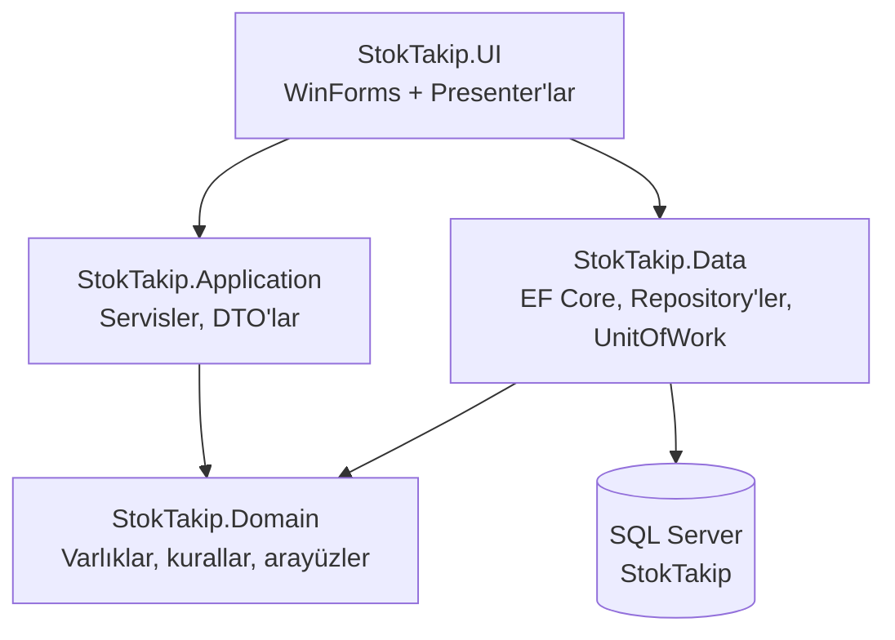
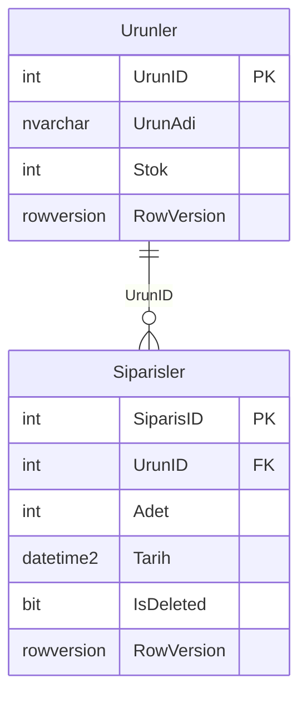

# 🧾 StokTakip - Basit Stok ve Sipariş Takip Uygulaması (C# & MSSQL)

Bu proje, küçük ve orta ölçekli işletmeler için geliştirilen **basit bir stok ve sipariş takip uygulamasıdır**. C# (WinForms, .NET 10) ve MSSQL kullanılarak geliştirilmiştir. Kullanıcılar ürün ekleyebilir, stok miktarlarını görüntüleyebilir, sipariş oluşturabilir ve sipariş geçmişini filtreleyip sayfa sayfa görüntüleyebilir, siparişleri silebilir.

Uygulama katmanlı bir yapıya taşınmıştır: iş kuralları Domain/Application katmanlarında, veritabanı erişimi EF Core ile Data katmanında, arayüz ise MVP (Model-View-Presenter) düzeninde UI katmanında bulunur.

---

## 📦 Özellikler

- ✅ Ürün ekleme, stok güncelleme ve silme (siparişi olan ürün silinemez)
- ✅ Ürün stok görüntüleme, **düşük stok renklendirmesi**: stok ≤ 10 ise "Kritik" (kırmızı), ≤ 25 ise "Düşük" (sarı)
- ✅ Sipariş oluşturma ve stoktan otomatik düşme (tek transaction; yetersiz stokta sipariş reddedilir)
- ✅ Sipariş geçmişi: **sayfalama** (25/50/100 kayıt), **tarih aralığı filtresi** ("Tüm tarihler" seçeneğiyle), **ürün adına göre arama**
- ✅ Sipariş silme: **yumuşak silme** (kayıt `IsDeleted` ile işaretlenir) ve silinen adedin **stoğa iadesi**; ana form ve açık geçmiş pencereleri otomatik yenilenir
- ✅ **Eşzamanlılık koruması**: `RowVersion` ile aynı kaydı iki kişi aynı anda değiştirirse ikinci işlem reddedilir, liste yenilenir ve kullanıcı uyarılır
- ✅ Uzun işlemlerde "Yükleniyor…" göstergesi, işlem sürerken butonların pasifleşmesi
- ✅ Türkçe hata mesajları ve dosyaya loglama (Serilog)
- ✅ Uygulama logosu ve simgesi (`assets/logo`)
- ✅ Veritabanı şeması EF Core migration'ları ile oluşturulur

---

## 🧰 Teknoloji Yığını

| Alan | Kullanılan |
|---|---|
| Platform | .NET 10 (`net10.0-windows` UI, `net10.0` kütüphaneler) |
| Arayüz | Windows Forms (MVP: Presenter + View arayüzleri) |
| Veri erişimi | Entity Framework Core 10 (SQL Server sağlayıcısı), Microsoft.Data.SqlClient |
| Veritabanı | Microsoft SQL Server (SQLEXPRESS / LocalDB da olur) |
| Yapılandırma / DI | Microsoft.Extensions.Configuration.Json, Microsoft.Extensions.DependencyInjection |
| Loglama | Serilog (dosya çıkışı) |
| Test | xUnit, NSubstitute, EF Core SQLite (bellek içi) |

---

## 🗂️ Proje Yapısı

```text
StokTakipApp/
├── src/
│   ├── StokTakip.Domain/        # Varlıklar (Urun, Siparis), iş kuralı istisnaları, repository arayüzleri
│   ├── StokTakip.Application/   # Servisler (StokService, SiparisService), DTO'lar
│   ├── StokTakip.Data/          # EF Core DbContext, repository'ler, UnitOfWork, Migrations/
│   └── StokTakip.UI/            # WinForms formları, Presenter'lar, Theme, appsettings.json
├── tests/
│   ├── StokTakip.Application.Tests/  # Servis ve domain kuralı testleri (NSubstitute)
│   └── StokTakip.Data.Tests/         # SQLite üzerinde entegrasyon testleri
├── assets/logo/                 # Logo (SVG/PNG) ve uygulama simgesi (app.ico)
├── screenshots/                 # README ekran görüntüleri
└── StokTakip.sln
```



UI yalnızca açılışta bağımlılıkları kaydetmek için Data'ya başvurur; formlar ve presenter'lar Application servisleri üzerinden çalışır.

---

## 🛠️ Kurulum ve Kullanım

### Gereksinimler

- .NET 10 SDK
- SQL Server (Express, Developer veya LocalDB)
- Windows (arayüz WinForms olduğu için)

### 1. Veritabanını Oluşturma (EF Core Migration)

Veritabanı artık `.bak` dosyasından restore edilmiyor; `StokTakip.bak` repoda yer almıyor. Şema, `src/StokTakip.Data/Migrations` altındaki migration'larla oluşturulur (`InitialCreate`, `SiparisRowVersion`).

`dotnet-ef` aracı repoda yerel araç olarak tanımlıdır (`.config/dotnet-tools.json`):

```powershell
dotnet tool restore
```

Migration komutları **Data projesi** üzerinden çalıştırılır. Data projesi kendi tasarım zamanı fabrikasını (`StokTakipDbContextFactory`) içerdiği için ayrıca `--startup-project` vermeye gerek yoktur. UI projesini başlangıç projesi olarak vermek (`--startup-project src/StokTakip.UI`) çalışmaz, çünkü UI projesi `Microsoft.EntityFrameworkCore.Design` paketine başvurmaz.

Komutlar bağlantı dizesini `appsettings.json`'dan okumaz. Sırasıyla şunlara bakılır:

1. `--connection "<bağlantı dizesi>"` parametresi
2. `STOKTAKIP_CONNECTION` ortam değişkeni
3. Hiçbiri yoksa `Server=(localdb)\MSSQLLocalDB;Database=StokTakip;Integrated Security=true;TrustServerCertificate=true`

**Yeni (boş) veritabanı:**

```powershell
# Migration listesini veritabanına bağlanmadan görmek için:
dotnet ef migrations list --project src/StokTakip.Data --no-connect

# Veritabanını oluşturmak / güncellemek için (appsettings.json ile aynı değeri kullanın):
$env:STOKTAKIP_CONNECTION = "Server=SUNUCU_ADINIZ;Database=StokTakip;Trusted_Connection=True;TrustServerCertificate=True;"
dotnet ef database update --project src/StokTakip.Data

# veya ortam değişkeni yerine doğrudan:
dotnet ef database update --project src/StokTakip.Data --connection "Server=SUNUCU_ADINIZ;Database=StokTakip;Trusted_Connection=True;TrustServerCertificate=True;"
```

Uygulama açılışta migration çalıştırmaz; veritabanı bu adımla önceden oluşturulmalıdır.

**Eski `.bak` dosyasından restore edilmiş bir veritabanınız varsa:**

`database update` komutunu doğrudan bu veritabanında çalıştırmayın. `Urunler` ve `Siparisler` tabloları zaten var olduğu için `InitialCreate` "There is already an object named 'Urunler'" hatasıyla durur. Önerilen yol:

1. Yeni adla boş bir veritabanı oluşturup yukarıdaki gibi `dotnet ef database update` çalıştırın.
2. Verileri aktarın: `SET IDENTITY_INSERT ... ON` açıp `INSERT INTO yeni.dbo.Urunler (UrunID, UrunAdi, Stok) SELECT UrunID, UrunAdi, Stok FROM eski.dbo.Urunler` çalıştırın. Ardından aynı şekilde `Siparisler (SiparisID, UrunID, Adet, Tarih)` tablosunu aktarın, `IsDeleted` alanına `0` yazın.
3. Aktarımdan önce negatif stoklu ya da `Adet <= 0` olan kayıt olmadığını kontrol edin; aksi halde CHECK kısıtları eklemeyi reddeder.

Alternatif (yerinde yükseltme): eski veritabanına eksik sütun, index ve kısıtları elle ekleyin (`Siparisler.IsDeleted bit NOT NULL DEFAULT 0`, `Urunler.RowVersion rowversion`, `IX_Siparisler_UrunID`, `IX_Siparisler_Tarih`, iki CHECK kısıtı). Ardından ilk migration'ı uygulanmış olarak işaretleyin:

```sql
INSERT INTO __EFMigrationsHistory (MigrationId, ProductVersion)
VALUES (N'20261018173356_InitialCreate', N'10.0.13');
```

Sonra `dotnet ef database update` ile kalan migration'ı (`Siparisler.RowVersion`) uygulayın. Bu yolda eski PK/FK adları EF'in ürettiği adlardan farklı kalır; ileride bu kısıtlara dokunan bir migration sorun çıkarabileceği için ilk yol tercih edilmelidir.

### 2. Yapılandırma (appsettings.json)

Eski `DatabaseHelper.cs` kaldırıldı. Bağlantı dizesi artık `src/StokTakip.UI/appsettings.json` içindedir (derlemede çıktı klasörüne kopyalanır):

```json
{
  "ConnectionStrings": {
    "StokTakip": "Server=SUNUCU_ADINIZ;Database=StokTakip;Trusted_Connection=True;TrustServerCertificate=True;"
  }
}
```

> `SUNUCU_ADINIZ` kısmını kendi bilgisayarınıza göre değiştirin. Örnek: `MONSTER\SQLEXPRESS`

> ⚠️ **`TrustServerCertificate=True` yalnızca geliştirme ortamı içindir.** Microsoft.Data.SqlClient varsayılan olarak şifreli bağlantı (`Encrypt=True`) kullanır; yerel SQLEXPRESS'in kendinden imzalı sertifikası bu ayar olmadan reddedilir. Üretimde sunucuya geçerli bir sertifika kurun ve bu ayarı kaldırın.

Dosya bulunamazsa, bozuksa ya da veritabanına bağlanılamazsa uygulama hatayı loglar ve Türkçe bir "Yeniden Dene / İptal" penceresi gösterir.

### 3. Çalıştırma

```powershell
dotnet run --project src/StokTakip.UI
```

veya Visual Studio'da `StokTakip.sln` açılıp `StokTakip.UI` başlangıç projesi yapılarak çalıştırılır. Çıktı dosyası `StokTakip.exe`'dir.

### 4. Loglar

Loglar `%LOCALAPPDATA%\StokTakip\logs\stoktakip-YYYYMMDD.log` dosyalarına günlük olarak yazılır ve **son 14 gün** saklanır. Ayarlar `appsettings.json` içindeki `Serilog` bölümündedir; göreli bir `path` verilirse `%LOCALAPPDATA%\StokTakip` altına çözülür. Ayar dosyası eksik veya hatalıysa aynı klasöre varsayılan ayarlarla yazılır. Yakalanmayan hatalarda kullanıcıya Türkçe mesaj gösterilir, ayrıntılar (yığın izi) yalnızca log dosyasında yer alır.

---

## 🖥️ Ekran Görüntüleri

### 📌 Ana Form
> Ürün listesi (düşük/kritik stok renklendirmesiyle), ürün işlemleri ve sipariş oluşturma ekranı


---

### 📌 Sipariş Geçmişi Formu
> Toplam sipariş/adet özeti, ürün araması, tarih aralığı filtresi, sayfalama ve sipariş silme ekranı


> İlk sürümün ekran görüntüleri karşılaştırma için `screenshots/anaform.png` ve `screenshots/siparisgecmisi.png` dosyalarında duruyor.

---

## 🧠 Yapısal Bilgi

### Sınıflar

- **Urun** (`StokTakip.Domain/Entities`)
  - Özellikler: `UrunId`, `UrunAdi` (en fazla 200 karakter), `Stok`, `RowVersion`
  - Metodlar: `AdiDegistir`, `StokAyarla`, `StokEkle`, `StoktanDus` (yetersiz stokta `YetersizStokException`)

- **Siparis** (`StokTakip.Domain/Entities`)
  - Özellikler: `SiparisId`, `UrunId`, `Adet`, `Tarih`, `IsDeleted`, `RowVersion`
  - Metodlar: `Olustur` (stoktan düşer), `Sil` (yumuşak silme + stok iadesi)

- **Servisler** (`StokTakip.Application/Services`)
  - `StokService`: ürün listeleme, ekleme, güncelleme, stok ayarlama, silme
  - `SiparisService`: sipariş oluşturma ve silme (transaction içinde), sayfalı sipariş geçmişi, özet

### SQL Tabloları

- `Urunler (UrunID, UrunAdi, Stok, RowVersion)`
  - `UrunID int IDENTITY` — PK: `PK_Urunler`
  - `UrunAdi nvarchar(200) NOT NULL`
  - `Stok int NOT NULL` — `CK_Urunler_Stok`: `Stok >= 0`
  - `RowVersion rowversion` — eşzamanlılık denetimi
- `Siparisler (SiparisID, UrunID, Adet, Tarih, IsDeleted, RowVersion)`
  - `SiparisID int IDENTITY` — PK: `PK_Siparisler`
  - `UrunID int NOT NULL` — FK: `FK_Siparisler_Urunler_UrunID` (`ON DELETE RESTRICT`: siparişi olan ürün silinemez), index: `IX_Siparisler_UrunID`
  - `Adet int NOT NULL` — `CK_Siparisler_Adet`: `Adet > 0`
  - `Tarih datetime2 NOT NULL DEFAULT GETDATE()` — index: `IX_Siparisler_Tarih`
  - `IsDeleted bit NOT NULL` — yumuşak silme; silinen siparişler sorgularda otomatik filtrelenir
  - `RowVersion rowversion` — eşzamanlılık denetimi



---

## 🧪 Test İçin Öneri

### Elle deneme

1. Ürün ekleyin; stoğu 10 veya altındaysa satır "Kritik", 25 veya altındaysa "Düşük" olarak renklenir.
2. Stok miktarını görüntüleyin ve güncelleyin.
3. Sipariş verin (stoktan düşer); mevcut stoktan fazla adet girildiğinde sipariş reddedilir.
4. Sipariş geçmişi formunu açın; ürün adıyla arayın, tarih aralığı seçin, sayfalar arasında gezinin.
5. Bir siparişi silin; adet ürünün stoğuna geri eklenir, ana form otomatik güncellenir.
6. Uygulamayı iki kez açıp aynı ürünü iki pencerede değiştirin; ikinci kayıt "Kayıt başka biri tarafından değiştirildi" uyarısıyla reddedilir ve liste yenilenir.

### Otomatik testler

```powershell
dotnet test StokTakip.sln
```

- `tests/StokTakip.Application.Tests`: servis ve domain kuralları (xUnit + NSubstitute ile sahte repository'ler).
- `tests/StokTakip.Data.Tests`: gerçek repository, UnitOfWork ve servislerle uçtan uca akışlar; bellek içi SQLite (`DataSource=:memory:`) üzerinde çalışır, SQL Server gerektirmez.

**SQLite testlerinin SQL Server'dan farkları:**

- **İzolasyon / eşzamanlılık:** SQLite tek yazıcılıdır ve `ReadCommitted` isteğini `Serializable`'a yükseltir; iki bağlantı aynı anda transaction açamaz. Bu yüzden SQL Server'daki kilit ve izolasyon yarışları birebir üretilemez. Testler yalnızca `RowVersion` denetimini (eski değerle yapılan UPDATE/DELETE'in reddedilmesini) doğrular. `RowVersion` değerini SQLite'ta veritabanı değil test altyapısı üretir.
- **`[` LIKE kaçışı:** Ürün aramasında `%`, `_` ve `[` karakterleri kaçışlanır. SQLite'ta `[` zaten joker karakter olmadığından bu kaçışın hatası yalnızca SQL Server'da ortaya çıkar.
- **Türkçe büyük/küçük harf:** SQLite LIKE yalnızca ASCII harflerde büyük/küçük harf duyarsızdır. `İ/i`, `I/ı` gibi Türkçe harflerin eşleşmesi SQL Server'da veritabanının collation ayarına bağlıdır ve testlerle kapsanmaz.
- Şema migration'larla değil `EnsureCreated` ile oluşturulur; `nvarchar(200)` uzunluk sınırı SQLite'ta zorlanmaz (sınır domain katmanında test edilir). CHECK kısıtları ve FK davranışı SQLite'ta da test edilir.

---

## 👨‍💻 Geliştirici Notları

- Proje .NET Framework 4.8'den .NET 10'a taşındı; eski `DatabaseHelper` sınıfı kaldırılarak SQL işlemleri EF Core repository'lerine ve `UnitOfWork`'e taşındı (parametresiz SQL birleştirme yok).
- Formlar pasif view'dır; iş akışı `AnaFormPresenter` ve `SiparisGecmisiPresenter` içindedir. Her işlem kendi DI kapsamında (ayrı `DbContext`) çalışır.
- `Form1` ve `SiparisGecmisiForm` birbirine referans tutmaz; değişiklikler `StokDegisiklikBildirimi` olaylarıyla iletilir (sipariş oluşturulunca açık geçmiş pencereleri, sipariş silinince ana form yenilenir).
- Veritabanı çağrıları async'tir; sipariş geçmişinde yeni sorgu bir öncekini iptal eder, form kapanınca bekleyen sorgular iptal edilir.
- İş kuralı ihlalleri (`YetersizStokException`, `GecersizGirdiException`, `EszamanlilikException` vb.) Türkçe uyarı olarak gösterilir. Silme gibi işlemlerden önce MessageBox ile onay alınır.
- Görünüm `Theme` sınıfında toplanmıştır (renkler, yazı tipleri, yüksek DPI uyumu, stok eşikleri `KritikStokEsigi = 10`, `DusukStokEsigi = 25`).

---

## 🧳 Lisans

Bu proje MIT lisansı ile lisanslanmıştır. Ayrıntılar için [LICENSE](LICENSE) dosyasına bakın.
